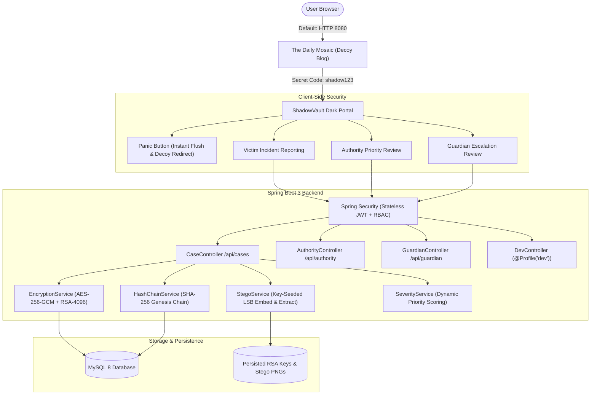
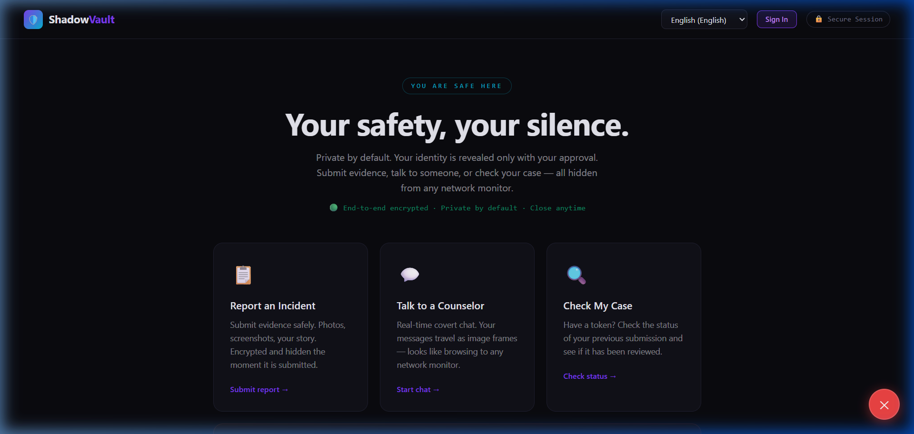
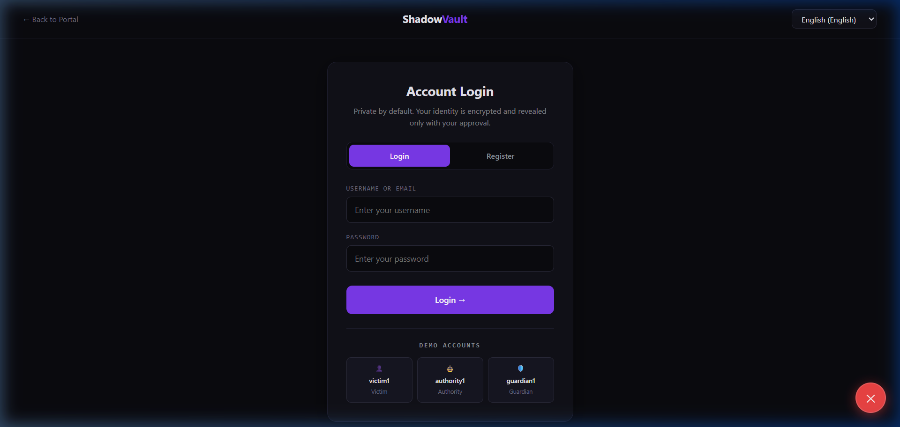
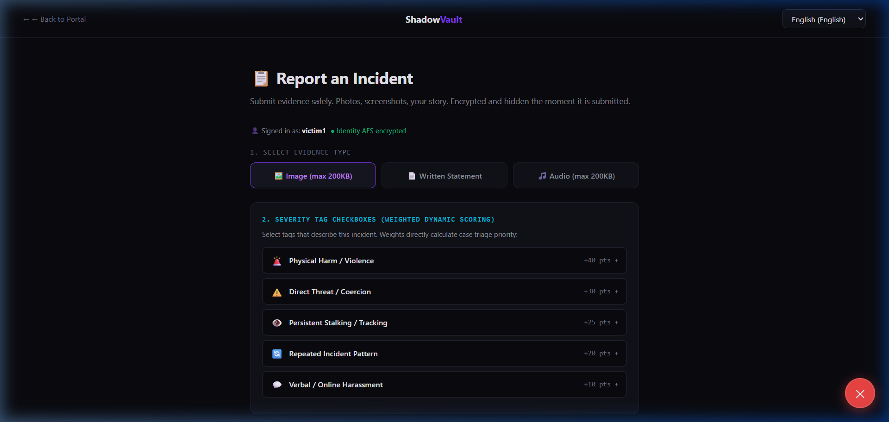
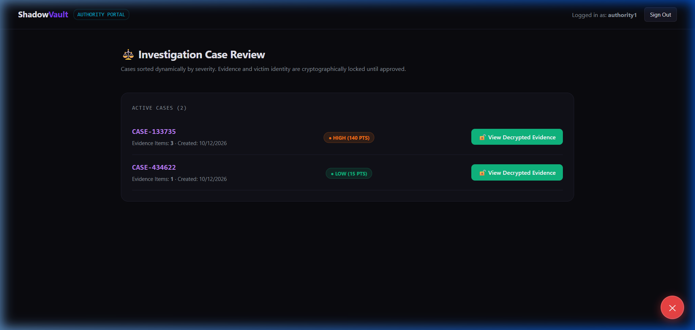
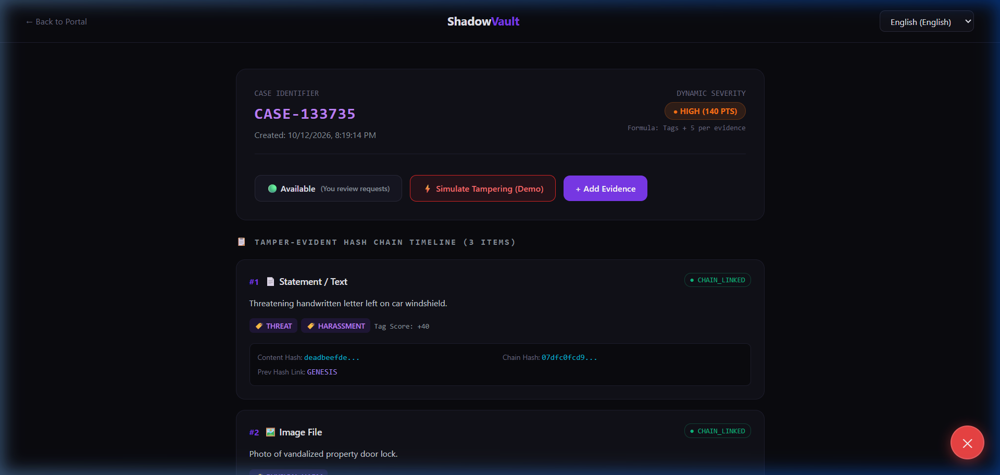
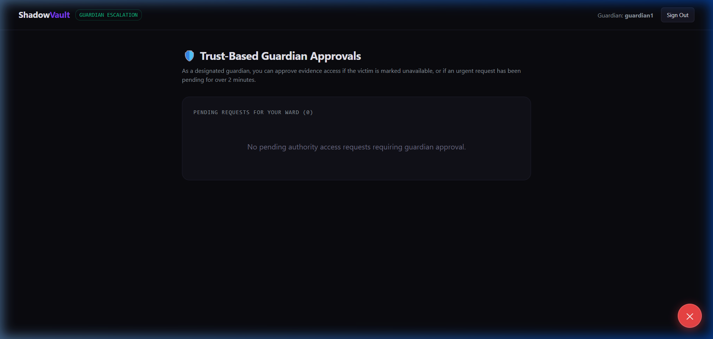
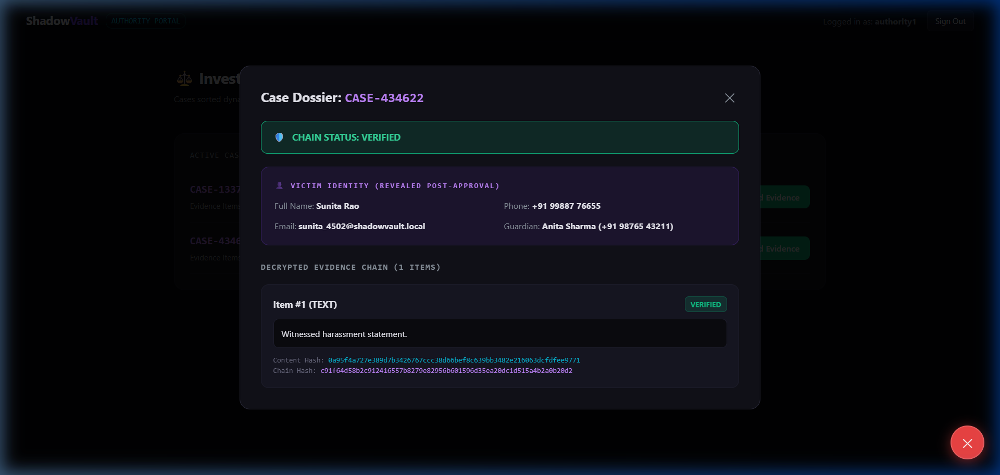
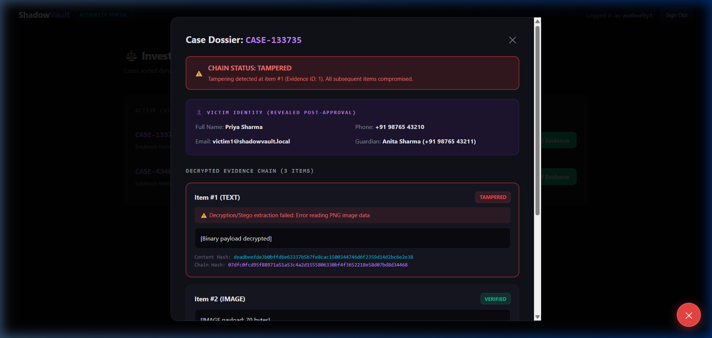

# ShadowVault 🛡️

> **Covert, Tamper-Evident Incident Reporting & Evidence Sealing Portal**  
> Disguised behind a tranquil lifestyle journal (*The Daily Mosaic*), ShadowVault gives victims an unmonitored channel to submit and seal evidence with military-grade envelope encryption (AES-256-GCM + RSA-4096), key-seeded LSB steganography, tamper-evident hash chaining, and zero-knowledge identity masking.

---

## 📑 Table of Contents
1. [Architecture Overview](#-architecture-overview)
2. [Security Design](#-security-design)
3. [Prerequisites](#-prerequisites)
4. [Quick Start (One Command)](#-quick-start-one-command)
5. [Docker Compose Setup](#-docker-compose-setup)
6. [Environment Variables](#-environment-variables)
7. [Demo Accounts & Secret Portal Unlock](#-demo-accounts--secret-portal-unlock)
8. [Testing & Verification](#-testing--verification)
9. [UI Walkthrough & Screenshots](#-ui-walkthrough--screenshots)
10. [REST API Reference](#-rest-api-reference)
11. [Database Verification SQL Queries](#-database-verification-sql-queries)
12. [Known Limitations](#-known-limitations)
13. [Troubleshooting](#-troubleshooting)

---

## 🏛️ Architecture Overview



---

## 🔒 Security Design

### 1. Envelope Encryption (AES-256-GCM + RSA-4096)
- **Per-Item Ephemeral AES Key:** Every uploaded evidence item is encrypted using AES-256 in Galois/Counter Mode (`AES/GCM/NoPadding`) with a unique 96-bit IV.
- **Asymmetric Key Wrapping:** The ephemeral AES key is wrapped with the authority's RSA-4096 public key (`RSA/ECB/OAEPWithSHA-256AndMGF1Padding`).
- **Zero Plaintext Storage:** Neither raw evidence data nor victim PII (full name, phone number, designated guardian details, or incident statements) are ever stored in plaintext anywhere in the database.

### 2. Key-Seeded Adaptive LSB Steganography
- The combined payload (RSA-wrapped key + IV + AES ciphertext) is packed with length prefixes and embedded into an innocuous PNG carrier using Least Significant Bit (LSB) steganography.
- Pixel coordinates for bit injection are pseudorandomly generated by seeding a PRNG with the wrapped AES key, preventing simple sequential bit analysis.

### 3. Merkle-Style Tamper-Evident Hash Chain
- Each evidence item computes:
  $$\text{contentHash} = \text{SHA-256}(\text{rawPayload})$$
  $$\text{chainHash} = \text{SHA-256}(\text{contentHash} \parallel \text{prevChainHash} \parallel \text{timestamp} \parallel \text{caseId} \parallel \text{victimId})$$
- For the first item, $\text{prevChainHash} = \text{"0"}^{64}$ (`GENESIS`).
- Modifying or corrupting any byte in an evidence file or database row immediately invalidates all subsequent links, marking the dossier as **`TAMPERED`** and pinpointing the exact compromised block.

### 4. Zero-Knowledge Identity Masking & Dual-Consent Access
- Authorities inspecting the intake queue see only dynamic severity scores, timestamps, and item counts; victim identity and evidence contents remain cryptographically locked.
- **Victim Approval:** The victim must review the investigation request and grant explicit consent.
- **Guardian Escalation Fallback:** If the victim is detained, hospitalized, or marks themselves as unavailable (or if a request is pending for over 2 minutes), their designated trusted guardian can authorize access on their behalf.

---

## 🛠️ Prerequisites

- **Java Development Kit:** JDK 17 or higher (tested with JDK 17 through JDK 25)
- **Build Tool:** Apache Maven 3.8+
- **Database:** MySQL 8.0+ running locally on port 3306 (or Docker)
- **Node.js (Optional for dev):** Node 18+ (only needed if building frontend from source)

---

## ⚡ Quick Start (One Command)

### Windows
Double-click `start.bat` in the project root:
```bat
start.bat
```
`start.bat` automatically checks MySQL connectivity on port 3306, loads configuration from `.env`, builds the JAR if needed, and launches the application with the `dev` profile enabled.

### Linux / macOS
Make executable and run `start.sh`:
```bash
chmod +x start.sh
./start.sh
```

Once started, navigate to:
- **Application URL:** [http://localhost:8080/](http://localhost:8080/)
- **Decoy Blog:** The Daily Mosaic lifestyle journal
- **Secret Unlock Code:** `shadow123` (type into the blog search bar and press enter)

---

## 🐳 Docker Compose Setup

Run the entire stack (MySQL 8 container + ShadowVault Spring Boot app) with Docker:

```bash
docker compose up --build
```

- MySQL 8 container initializes with persistent volume `mysql_data` and built-in healthchecks.
- Spring Boot waits for MySQL health before launching on port `8080`.
- Access the app immediately at [http://localhost:8080/](http://localhost:8080/).

To stop:
```bash
docker compose down
```

---

## ⚙️ Environment Variables

Configuration is loaded from `.env` in the project root (see `.env.example`):

| Variable | Description | Safe Default |
|---|---|---|
| `DB_URL` | MySQL 8 JDBC connection URL | `jdbc:mysql://localhost:3306/shadowvault?createDatabaseIfNotExist=true&useSSL=false&allowPublicKeyRetrieval=true` |
| `DB_USER` | MySQL database username | `root` |
| `DB_PASS` | MySQL database password | `demo123` *(set in local .env)* |
| `JWT_SECRET` | 256-bit hex signing key for HMAC-SHA256 | `4f7b2c9e8d1a5f0e3c6a9b2d5f8e1c4b7a0d3f6e9c2b5a8d1e4f7a0c3b6e9d28` |
| `AUTHORITY_ACCESS_CODE` | Secret authorization code required to register an Authority account | `AUTH-2026` |
| `DATA_DIR` | Storage path for authority RSA keys & stego images | `./data` |
| `SPRING_PROFILES_ACTIVE` | Active Spring profile (`dev` enables tamper endpoint) | `dev` |

---

## 🔐 Real Role-Based Registration & Authentication

ShadowVault enforces production-grade authentication with BCrypt password hashing (minimum length of 8 characters) and role-segregated onboarding:

### 1. Victim Registration
- **Fields:** Full Name, Phone Number, Email, Username, Password (min 8 chars), optional Guardian Name & Phone.
- **Workflow:**
  1. Victim fills out the registration form.
  2. Identity details are client-side validated and AES-256 encrypted.
  3. A simulated 6-digit SMS OTP is issued for account verification.
  4. A **One-Time Guardian Invite Code** (format: `GRD-XXXXXX`) is generated and securely stored on the victim's record.
  5. The victim shares this invite code with their trusted guardian.

### 2. Guardian Registration & Linking
- **Fields:** Full Name, Phone Number, Email, Username, Password (min 8 chars), and the victim's **Guardian Invite Code**.
- **Workflow:**
  1. Guardian inputs their details along with the ward's `GRD-XXXXXX` invite code.
  2. The server validates the code and rejects invalid/unregistered codes.
  3. On success, the guardian is cryptographically linked to the victim in the database.
  4. Guardians can view and approve access requests *only* for wards linked to them by invite code (when the victim is marked unavailable or the request has been pending over 2 minutes).

### 3. Authority Registration
- **Fields:** Full Name, Department (e.g. *Cyber Crime Investigation Cell*), Email, Username, Password (min 8 chars), and the **Authority Access Code**.
- **Workflow:**
  1. Law enforcement personnel enter their official credentials and the agency authorization code.
  2. The code is validated against the configured access code:
     - **Default Code:** **`AUTH-2026`**
     - **Configurable via:** `AUTHORITY_ACCESS_CODE` environment variable or `shadowvault.authority.access-code` property.
  3. Wrong codes are immediately rejected with an authorization error.

> **Note on Demo Fallbacks:**  
> Seeded demo accounts (`victim1`, `authority1`, `guardian1` with password `demo123`) remain in the database strictly as a hidden fallback for automated tests. The login UI contains zero demo buttons or hardcoded credentials.

---

## 🗝️ Secret Portal Unlock

On the decoy lifestyle blog homepage (`http://localhost:8080/#/`), type **`shadow123`** into the search bar. The interface transitions immediately into the secure ShadowVault application portal.

---

## 🧪 Testing & Verification

### 1. Maven Unit & Flow Integration Tests
Run all 28 automated tests (including encryption, hash chain, dynamic severity, steganography, role registration, validation rejections, and unlinked guardian escalation checks):
```bash
cd backend
mvn clean test
```
*Note: Testcontainers integration tests run automatically in CI or on machines with active Docker daemons, and skip gracefully when Docker is absent via `@Testcontainers(disabledWithoutDocker = true)`.*

### 2. End-to-End PowerShell Integration Test Suite (Brand-New Accounts)
To execute the complete end-to-end lifecycle from scratch with brand-new accounts against MySQL 8:
```powershell
powershell -ExecutionPolicy Bypass -File .\test_full_flow.ps1
```
Tests executed:
1. `1_RegisterVictim`: Registers brand-new victim, generates simulated OTP & Guardian Invite Code (`GRD-XXXXXX`)
2. `2_RegisterGuardian`: Registers brand-new guardian linked to the victim using the invite code
3. `3_RegisterAuthority`: Registers brand-new authority using the access code `AUTH-2026`
4. `4_UploadTwoItems`: Uploads Text statement and Image evidence into an unbroken SHA-256 hash chain
5. `5_AuthorityRequestAccess`: Authority files official access request (status: PENDING)
6. `6_VictimMarksUnavailable`: Victim marks self UNAVAILABLE to activate guardian escalation
7. `7_GuardianApproves`: Linked guardian verifies ward request and approves emergency access
8. `8_AuthorityDecryptVerified`: Authority decrypts evidence and verifies chain integrity (`VERIFIED`)
9. `9_TamperDetectionTampered`: Injects cryptographic tampering via dev endpoint and verifies detection (`TAMPERED`)

---

## 📸 UI Walkthrough & Screenshots

The complete workflow captured from live execution on `http://localhost:8080`:

| Step & Description | Screenshot Preview |
|---|---|
| **1. Decoy Blog Homepage**<br>Innocent lifestyle journal (*The Daily Mosaic*) serving at root `/` to hide digital presence from abusers. |  |
| **2. Secret Vault Unlock**<br>Typing the covert trigger code (`shadow123`) into the blog search bar reveals the dark vault router. |  |
| **3. Authentication & One-Click Demo**<br>Secure login and registration with simulated OTP generation and demo quick-fill logins. |  |
| **4. Incident Reporting & Evidence Sealing**<br>Multipart evidence upload with automatic severity scoring and adaptive LSB steganography preview. |  |
| **5. Authority Review Queue (Zero-Knowledge Masking)**<br>Authorities observe intake cases prioritized by dynamic severity while victim identity is cryptographically masked. |  |
| **6. Victim Dual-Consent Approval**<br>Victims review incoming formal access requests from authorities and grant explicit consent. |  |
| **7. Guardian Escalation Review**<br>Designated guardians can authorize emergency access if a victim is silenced, detained, or unresponsive. |  |
| **8. Decrypted Dossier & Verified Hash Chain**<br>Authoritative review screen with decrypted evidence items and verified cryptographic SHA-256 chain. |  |
| **9. Real-Time Tamper Detection**<br>Simulated byte corruption instantly flags the evidence dossier as `TAMPERED` and identifies the compromised block. |  |

---

## 📡 REST API Reference

| Method | Endpoint | Allowed Roles | Description |
|---|---|---|---|
| `POST` | `/api/auth/register` | Public | Registers a victim, generates simulated OTP, encrypts identity PII |
| `POST` | `/api/auth/login` | Public | Authenticates credentials, returns signed JWT & role |
| `GET` | `/api/auth/me` | Authenticated | Returns current authenticated user profile & decrypted identity |
| `POST` | `/api/auth/toggle-availability` | `ROLE_VICTIM` | Toggles victim status between Available and Unavailable |
| `GET` | `/api/cases/my` | `ROLE_VICTIM` | Retrieves victim's active case, timeline, and pending access requests |
| `POST` | `/api/cases/evidence` | `ROLE_VICTIM` | Multipart upload (text/image/audio), embeds stego, links hash chain |
| `POST` | `/api/cases/requests/{id}/respond` | `ROLE_VICTIM` | Approves or rejects authority access request |
| `GET` | `/api/authority/cases` | `ROLE_AUTHORITY` | Retrieves cases sorted by dynamic severity with masked victim PII |
| `POST` | `/api/authority/cases/{caseId}/request-access` | `ROLE_AUTHORITY` | Submits formal case access request |
| `GET` | `/api/authority/cases/{caseId}/evidence` | `ROLE_AUTHORITY` | Decrypts evidence dossier & performs full hash-chain audit |
| `GET` | `/api/guardian/requests` | `ROLE_GUARDIAN` | Lists pending requests for ward with escalation eligibility |
| `POST` | `/api/guardian/requests/{id}/respond` | `ROLE_GUARDIAN` | Approves or rejects access as designated guardian |
| `POST` | `/api/dev/tamper/{id}` | `dev` profile only | Corrupts specific evidence item to demonstrate tamper detection |
| `POST` | `/api/dev/tamper-latest` | `dev` profile only | Corrupts latest evidence item to test audit alert |

---

## 🔍 Database Verification SQL Queries

Verify that victim PII is stored strictly as encrypted ciphertexts:

```sql
-- Connect to MySQL
USE shadowvault;

-- 1. Verify encrypted user identities (Zero plaintext names/phones)
SELECT id, username, role, 
       SUBSTRING(encrypted_name, 1, 24) AS enc_name, 
       SUBSTRING(encrypted_phone, 1, 24) AS enc_phone,
       SUBSTRING(guardian_name, 1, 24) AS enc_gname 
FROM users;

-- 2. Verify evidence encryption, wrapped keys, and hash links
SELECT id, case_id, evidence_type, 
       SUBSTRING(description, 1, 24) AS enc_desc,
       SUBSTRING(wrapped_aes_key, 1, 24) AS rsa_wrapped_key,
       SUBSTRING(content_hash, 1, 16) AS content_hash,
       SUBSTRING(chain_hash, 1, 16) AS chain_hash
FROM evidence_items;

-- 3. Verify access request audit trail
SELECT id, case_id, requester_id, status, reason, approved_by_role, created_at 
FROM access_requests;
```

---

## ⚠️ Known Limitations

1. **Simulated OTP Delivery:** SMS OTP verification during victim registration is simulated and displayed in the UI. In production, integrating third-party SMS providers (e.g., Twilio) requires careful consideration because SMS messages received on a shared device may compromise victim safety.
2. **Demo Credentials:** The seeded accounts (`victim1`, `authority1`, `guardian1` with password `demo123`) are provided strictly for demonstration and testing. For production deployments, disable demo seeding by removing the seeding logic or overriding `spring.sql.init.mode=never`.
3. **Testcontainers Docker Prerequisite:** Integration tests in `ShadowVaultIntegrationTest` require a running Docker daemon to spin up ephemeral MySQL containers. When Docker is unavailable, tests automatically skip via `@Testcontainers(disabledWithoutDocker = true)`, while unit and mock integration tests continue to run.
4. **Ephemeral Cloud Storage on Free Tiers:** Free-tier hosting providers (e.g., Render, Railway free tier) use ephemeral container filesystems. Any files saved to `./data` (such as steganography carrier PNGs and RSA keys) will be wiped on container restart unless a persistent volume or remote cloud storage bucket (AWS S3, Google Cloud Storage) is attached.

---

## ❓ Troubleshooting

1. **MySQL Access Denied (Error 1045):**
   - Verify `DB_PASS` in `.env` matches your local MySQL root password.
   - Test login via CLI: `mysql -u root -p`
2. **Port 8080 Already in Use:**
   - Stop conflicting services: `Get-Process -Id (Get-NetTCPConnection -LocalPort 8080).OwningProcess | Stop-Process`
3. **Tamper Simulation Endpoint Returns 404:**
   - Dev endpoints (`/api/dev/**`) require the `dev` profile. Ensure the application is started with `--spring.profiles.active=dev` (default in `start.bat`, `start.sh`, and `docker-compose.yml`).
4. **Static UI Not Serving:**
   - Re-build the frontend into backend static resources:
     ```bash
     cd frontend && npm run build
     cd .. && Copy-Item frontend/dist/* backend/src/main/resources/static/ -Recurse -Force
     ```
